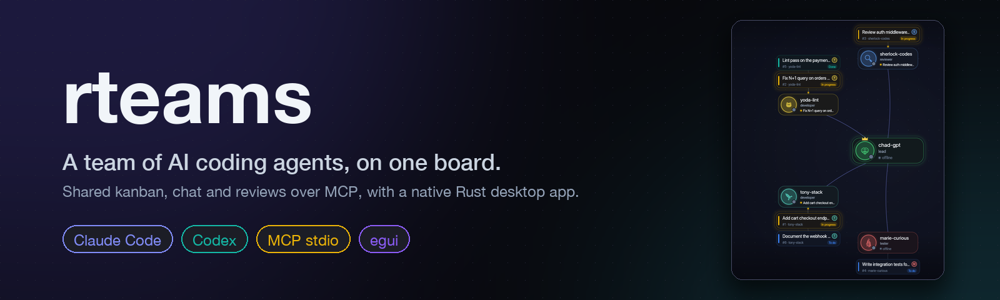
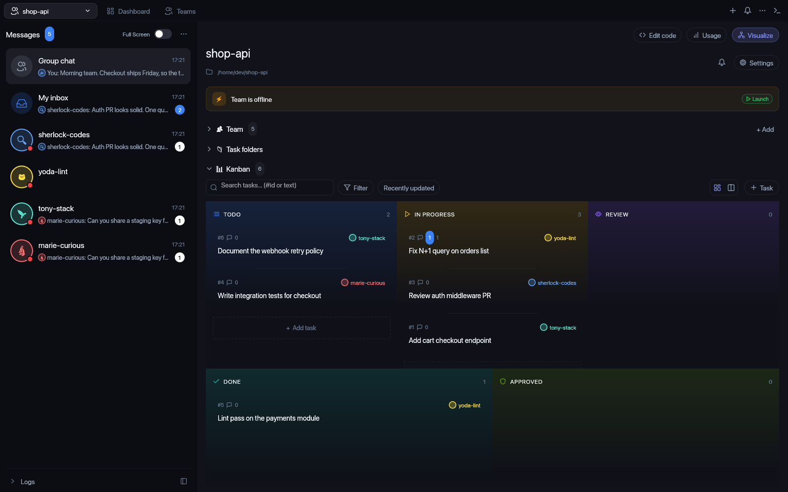
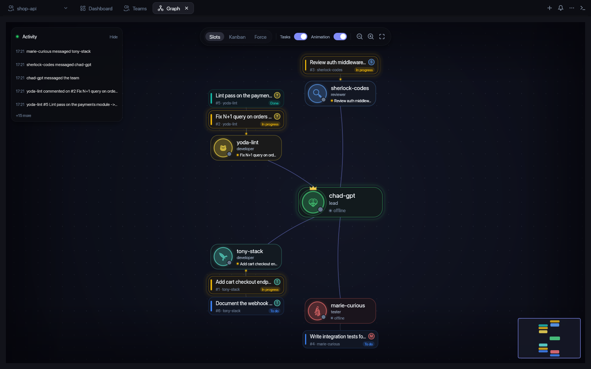
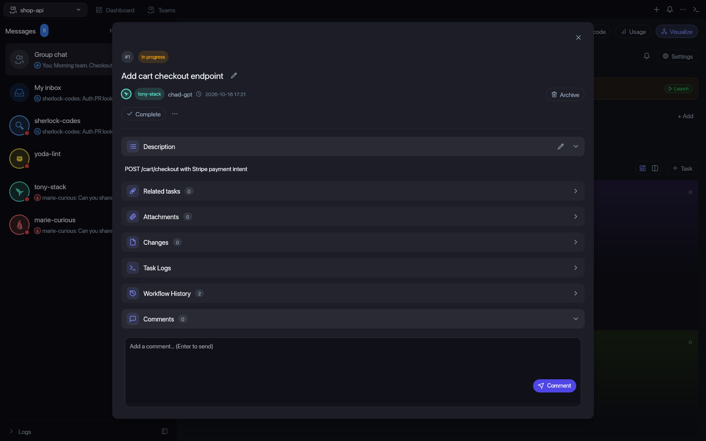
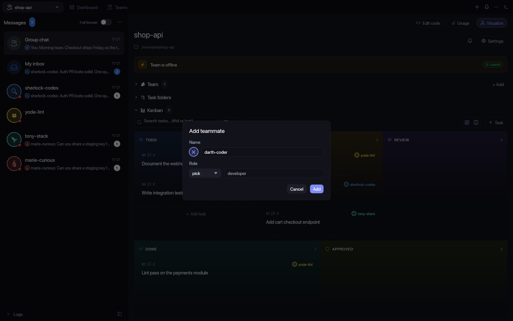
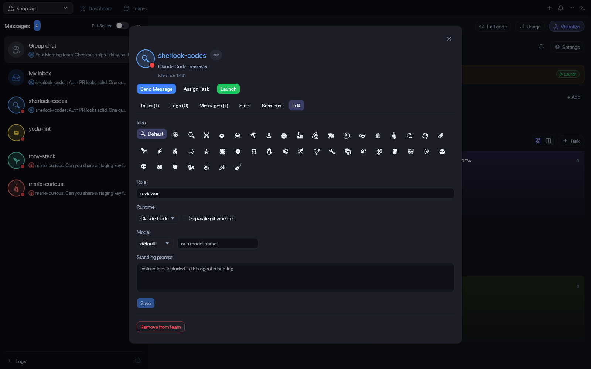

# rteams





A small team-coordination server for AI agents (tasks, review, messages, briefings), spoken over
MCP on stdio. Each agent's Claude Code starts its own `rteams serve` process; all of them share
one durable event log, so the team shares one board.

## Use it with Claude Code

Tested with Claude Code 2.1.301: the server reports `connected` and every tool is exposed to the
model as `mcp__rteams__<tool>`.

### 1. Install the binary

```sh
cargo install --path crates/rteams-cli   # puts `rteams` in ~/.cargo/bin
```

(Or use the absolute path to `target/debug/rteams` after `cargo build`.)

### 2a. Project-local `.mcp.json` (checked in, shared by the whole team)

```json
{
  "mcpServers": {
    "rteams": {
      "command": "rteams",
      "args": ["serve", "--home", "/abs/path/to/shared/rteams-home", "--team", "my-team"]
    }
  }
}
```

The same thing through environment variables:

```json
{
  "mcpServers": {
    "rteams": {
      "command": "rteams",
      "args": ["serve"],
      "env": { "RTEAMS_HOME": "/abs/path/to/shared/rteams-home", "RTEAMS_TEAM": "my-team" }
    }
  }
}
```

Claude Code asks you to approve a project-scoped server the first time you run `claude` in that
directory (`claude mcp list` shows it as "Pending approval" until then).

### 2b. Or register it with the CLI

```sh
claude mcp add rteams -e RTEAMS_HOME=/abs/path/to/shared/rteams-home -e RTEAMS_TEAM=my-team \
  -- rteams serve
# add --scope project to write .mcp.json, --scope user to make it available everywhere
claude mcp list        # runs a health check; expect "rteams: ... - Connected"
```

### 3. Allow the tools (optional)

```sh
claude --allowedTools "mcp__rteams"      # all rteams tools, no per-call prompts
```

## Configuration

`rteams [serve] [--home DIR] [--team NAME]`

| Flag / env | Meaning |
|---|---|
| `--home DIR` / `RTEAMS_HOME` | Shared state root. State lives in `<home>/<team>/events.jsonl`. Omit for in-memory state private to that process (fine for a demo, useless for several agents). |
| `--team NAME` / `RTEAMS_TEAM` | Team directory under the home. Default `default`. |
| `RTEAMS_MEMBER` | The member this server process acts as. Required by `permission_request` (the launcher sets it per agent). |
| `RTEAMS_PERMISSION_TIMEOUT_MS` | How long `permission_request` waits for a lead's decision before denying. Default 600000 (10 min). |

Flags win over environment variables. Every agent that should see the same board must use the
same home and team. Writes take a file lock, catch up with other processes, then validate against
the latest state, so concurrent agents are safe.

## Desktop app (rteams-gui)

`rteams-gui` is a native Rust rebuild of [agent-teams-ai](https://github.com/777genius/agent-teams-ai):
you are the lead, Claude Code agents are your team, you watch the kanban and give commands. Same
dark "Midnight Slate" look; no Electron, no provider zoo, no cloud.

- **Tabs:** the team, and `Teams` (all teams under the home; search, `Create Team`, switch).
- **Messages (left):** Group chat + one chat per agent, unread badges (saved per team),
  full-screen chat with a composer: recipient, `Do | Ask | Delegate`, Send.
- **Team:** header with project path, `Launch` / `Stop team`, offline banner, `⚙ Settings`
  (project path, lead prompt); member rows with status, task progress, chat, assign, launch /
  stop / restart; `+ Add` teammate; member dialog (tasks, logs, messages, edit role / model /
  standing prompt, remove / restore).
- **Kanban:** TODO / IN PROGRESS / REVIEW / DONE / APPROVED in the original 3+2 grid or a
  columns view; search (`#id` or text), filters, sort, hover actions, Trash with restore.
- **Task dialog:** edit title / description, actions for the current status, related tasks,
  task logs, workflow history, comments.
- **Claude Logs** and **Processes** sections; OS notifications for reviews, messages, done.
- **Member names and icons:** `+ Add` prefills the next free parody name (`chad-gpt`,
  `sherlock-codes`, `yoda-lint`, `gandalf-the-grep`, `tony-stack`, ...); type over it to use
  your own. Every avatar shows an icon: the parody's own, one derived from the name, or one you
  pick in the member's Edit tab (`member_update` takes `icon`).

| Graph view | Task dialog |
|---|---|
|  |  |
| **Add a teammate** | **Pick a member icon** |
|  |  |

**How agents run (token-frugal by design).** Each agent is a one-shot `claude -p` run wired to
`rteams serve` for the team. Nobody idles or polls: the GUI wakes an agent only when the log
gives it work (a message to it, an assignment, a review request, changes requested, a comment
on its task, an unblock), coalesces bursts (2 s debounce), rate-limits (20 s gap, 6/hour) and
caps concurrency at 3. The wake prompt already holds the reason, the agent's top tasks and
unread messages, so it skips briefing calls; each member's Claude session is resumed. Modes:
`Do` (full tools), `Ask` (read-only), `Delegate` (only rteams tools: create and assign tasks).
Agents run with all permissions (`--dangerously-skip-permissions`), like the original. Runs are
recorded to `<home>/<team>/runs/<member>/*.jsonl`; sessions in `<home>/<team>/sessions.json`.

```sh
cargo build --release -p rteams-gui -p rteams-cli   # gui finds `rteams` next to itself
./target/release/rteams-gui --home ~/rteams-home --team demo
```

Flags: `--home DIR` (env `RTEAMS_HOME`, required), `--team NAME` (env `RTEAMS_TEAM`, default
`default`), `--as NAME` (env `RTEAMS_ACTOR`, default: the team's lead).

## Terminal UI (rteams-tui)

```sh
cargo run -p rteams-tui -- --home ~/.rteams --team NAME [--as NAME]
```

Five-column kanban, task detail, messages and a command line. Writes go through the same
server tools as the GUI; the view tails the log and refreshes every 500 ms. Keys: arrows or
`hjkl` move, `Enter` opens a task (its comments show), `m` message (`@name text` is direct,
otherwise broadcast), `c` comment, `s` start, `d` done, `q` quit.

## Things to know when calling the tools

- **`actor` is explicit.** The server has no login: write tools take `actor` (your member name)
  on every call, and read tools take `member`. Put each agent's name in its prompt or
  `CLAUDE.md`.
- **First call is `team_create`.** The actor that creates the team joins as role `lead`; list the
  other members in the same call. Do it once per team directory.
- **Start of a session:** `member_briefing { member }` (team, roster, who leads, queue sizes,
  protocol), then `task_briefing { member }` for the work queue. `task_briefing` with
  `role: "lead"` adds the team-wide view and is only allowed for members with the lead role.
- **Idempotent writes.** Every write tool accepts an optional `command_id`; retrying with the same
  id returns the original result instead of appending a second event.
- **Errors.** Domain failures (`task_not_found`, `illegal_transition`, `forbidden`,
  `unknown_member`, ...) come back as tool results with `isError: true` and a `{code, message}`
  body, so the model can read and react. Malformed arguments and unknown tools are JSON-RPC
  `-32602` errors.
- **Tools (76; all 51 of the original app's MCP tools plus 25 rteams-only):**
  Team: `team_create`, `team_get`, `team_list`, `team_configure`, `team_update`, `team_launch`,
  `team_stop`, `team_trash`, `team_delete`, `team_get_launch_state`, `member_add`, `member_update`,
  `member_remove`, `member_briefing`, `lead_briefing`, `task_briefing`, `app_get_connection_info`.
  Tasks: `task_create`, `task_create_from_message`, `task_get`, `task_list`, `task_update`,
  `task_start`, `task_complete`, `task_set_status`, `task_set_owner`, `task_set_dependencies`,
  `task_link`, `task_unlink`, `task_block`, `task_unblock`, `task_archive`, `task_restore`,
  `task_set_clarification`, `task_attach_file`, `task_add_comment`, `task_get_comment`,
  `task_comment_files`, `task_attach_comment_file`. Kanban / review: `kanban_get`,
  `kanban_set_order`, `kanban_set_column`, `kanban_clear`, `kanban_add_reviewer`,
  `kanban_remove_reviewer`, `kanban_list_reviewers`, `review_request`, `review_start`,
  `review_approve`, `review_request_changes`. Messages: `message_send`, `message_react`,
  `inbox_get`, `group_chat_create` / `_update` / `_delete` / `_list`, `cross_team_list_targets`,
  `cross_team_send`, `cross_team_get_outbox`. Processes: `process_register`, `process_list`,
  `process_stop`, `process_unregister`. Runtime: `runtime_heartbeat`, `runtime_bootstrap_checkin`,
  `runtime_deliver`, `runtime_deliver_message`, `runtime_task_event`. Work sync:
  `member_work_sync_status`, `member_work_sync_report`, `member_work_sync_ack`. Schedules /
  permissions: `schedule_set`, `schedule_remove`, `permission_request`, `permission_decide`.
  Lead-only: team lifecycle, `kanban_*` column/reviewer writes, `schedule_*`, `permission_decide`,
  `lead_briefing`. `member_add` / `member_update` accept `runtime` (`claude` default, `codex`,
  `opencode`, `cursor`, `gemini`, ...); `member_update` also takes `worktree`, `effort`, `fast`,
  `context_limit`, `mcp_allow` (lead only). `tools/list` is the source of truth.

`permission_request {tool_name, input}` is the Claude `--permission-prompt-tool` contract: it
records a request for `RTEAMS_MEMBER`, then blocks (polling the shared log every 500 ms, without
holding the store lock) until a lead calls `permission_decide`, or denies on timeout. The reply
text is `{"behavior":"allow","updatedInput":...}` or `{"behavior":"deny","message":...}`.

## Troubleshooting

- **Handshake fails / server shows "Failed to connect":** stdout must carry only JSON-RPC.
  rteams logs to stderr only (one line, `rteams: state in <dir>`). If you wrap the binary in a
  script, do not `echo` or let a shell profile print anything to stdout.
- **Tools never appear:** run `claude mcp list` in the project directory; "Pending approval"
  means you have not approved the `.mcp.json` server yet.
- **Agents do not see each other's tasks:** they are using different `--home` / `--team` values,
  or no home at all (in-memory state).
- Run the server by hand to inspect it:
  ```sh
  printf '%s\n' '{"jsonrpc":"2.0","id":1,"method":"initialize","params":{"protocolVersion":"2025-06-18","capabilities":{},"clientInfo":{"name":"t","version":"1"}}}' \
    '{"jsonrpc":"2.0","id":2,"method":"tools/list"}' | rteams serve
  ```

## Protocol

Hand-rolled JSON-RPC 2.0 over newline-delimited stdio. Supports `initialize` (negotiates
`2025-06-18`, `2025-03-26`, `2024-11-05`; an unknown newer client version gets `2025-06-18`),
`notifications/initialized`, `ping`, `tools/list`, `tools/call`. Advertised capabilities:
`tools` only; `resources/*` and `prompts/*` answer `-32601`. Successful tool results carry both
a text `content` block and `structuredContent`.

`crates/rteams-cli/tests/claude_code.rs` replays the Claude Code client sequence against the real
binary on every CI run.

## Development

`scripts/ci.sh` runs the same checks as CI: `cargo fmt --check`, `cargo clippy -D warnings`,
`cargo test --workspace`.
